<div align="center">

# CareerNest

**A full-stack job discovery and application-tracking platform with smart job-match scoring.**

[](https://github.com/rishitsharma017/career-nest/actions/workflows/ci.yml)


</div>

---

## Overview

CareerNest helps candidates **find jobs, see how well they fit each role, and track every application** in one place.
The React frontend talks to an Express REST API backed by a SQLite database. A matching engine scores each job against the candidate's profile and explains the score.

<p align="center">
  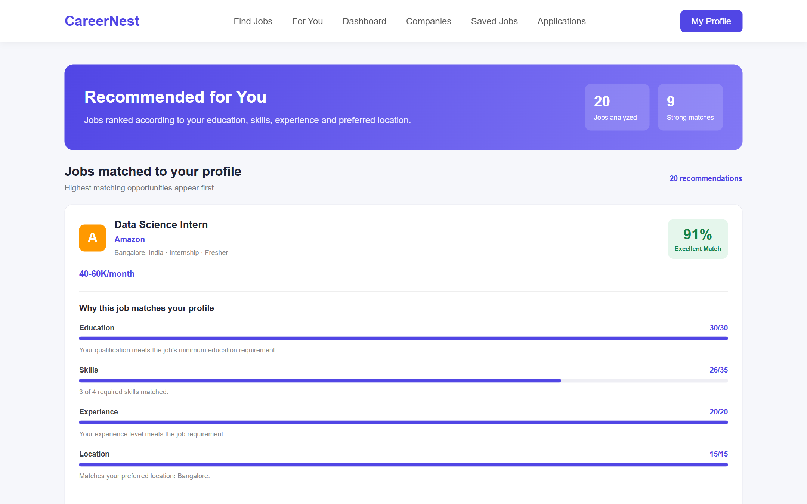
</p>

## Screenshots

<table>
  <tr>
    <td align="center"><b>Find Jobs</b><br>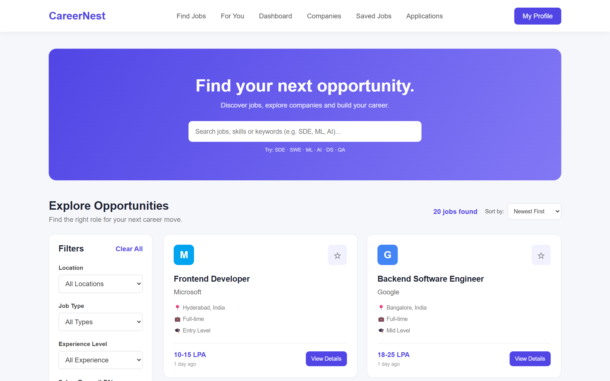</td>
    <td align="center"><b>Dashboard</b><br>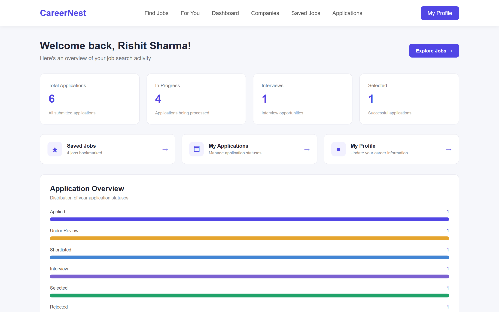</td>
  </tr>
  <tr>
    <td align="center"><b>Application Tracking</b><br>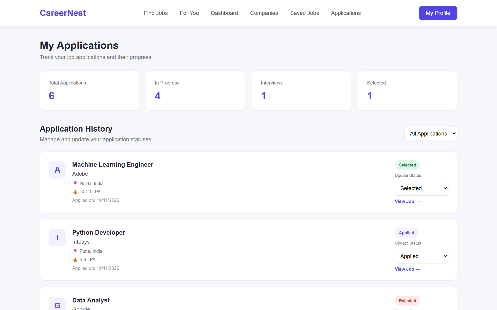</td>
    <td align="center"><b>Job Details</b><br>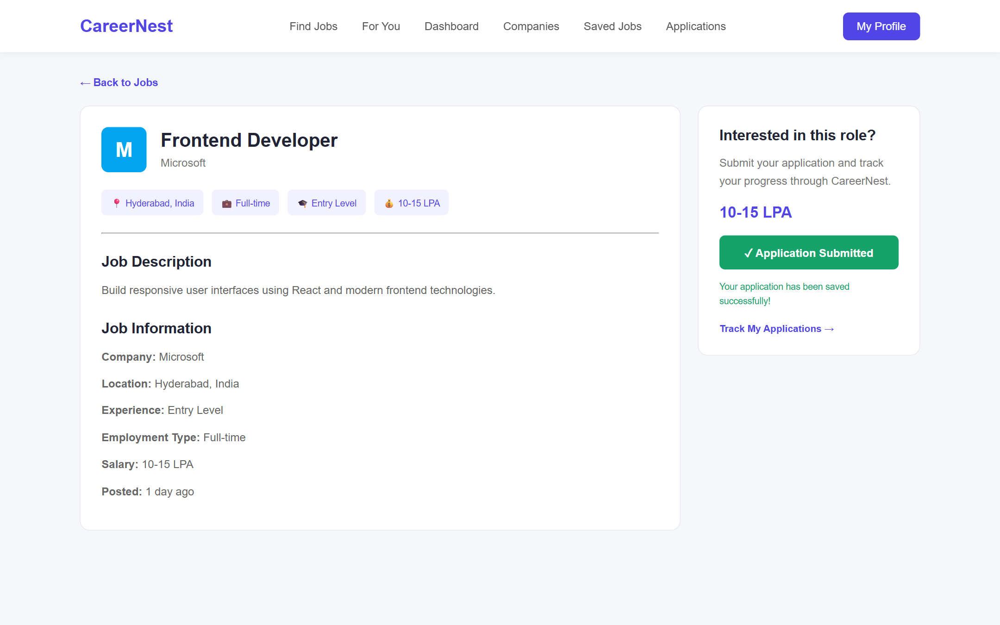</td>
  </tr>
  <tr>
    <td align="center"><b>Companies</b><br>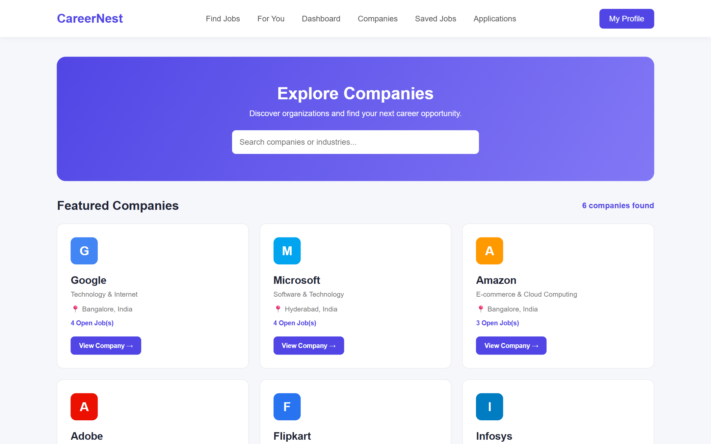</td>
    <td align="center"><b>Company Profile</b><br>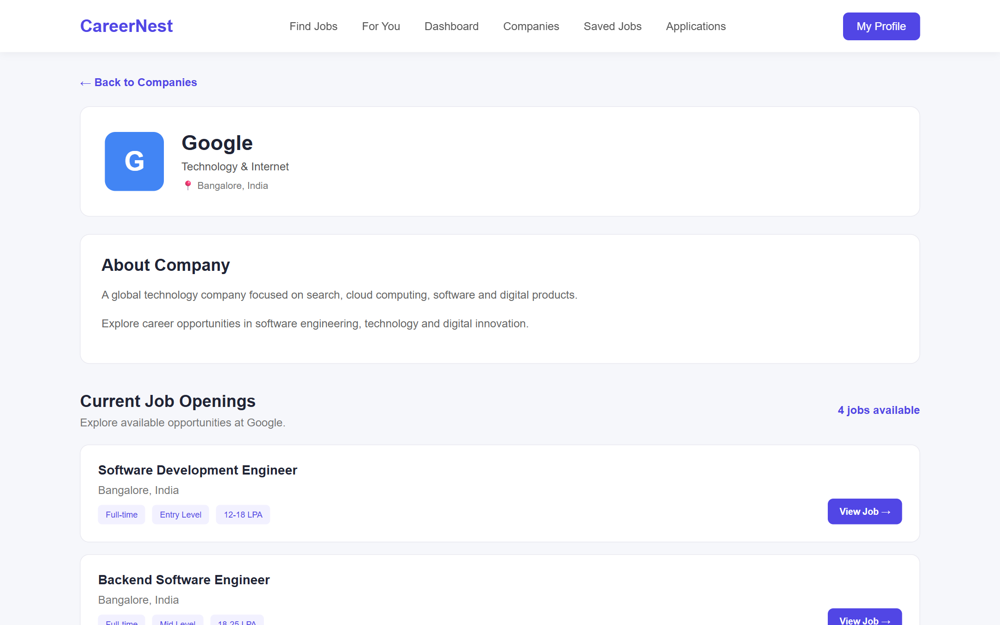</td>
  </tr>
  <tr>
    <td align="center"><b>Saved Jobs</b><br>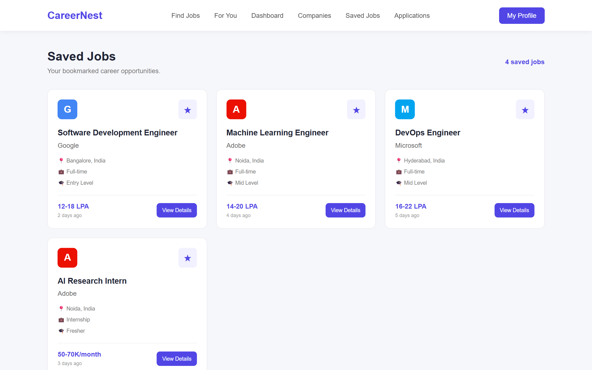</td>
    <td align="center"><b>Candidate Profile</b><br>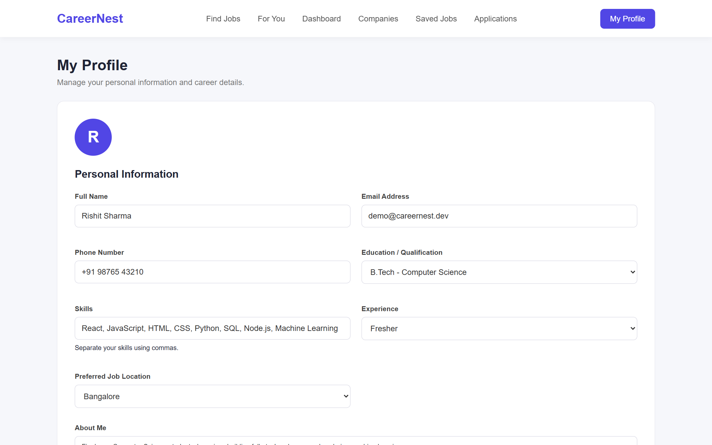</td>
  </tr>
</table>

<details>
<summary><b>Mobile view</b></summary>
<br>
<p align="center">
  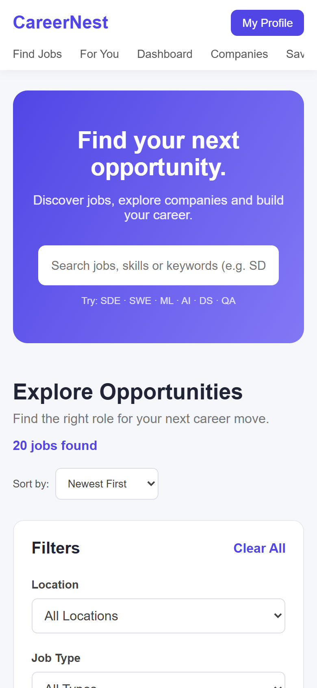
  &nbsp;&nbsp;
  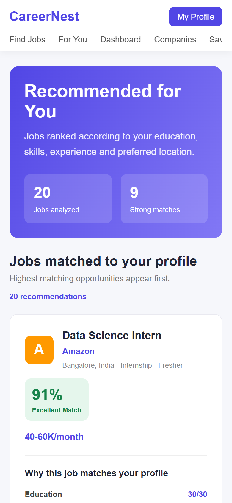
</p>
</details>

## Features

| Feature | Description |
| --- | --- |
| **Job search & filters** | Keyword search with suggestions. Filter by location, job type, experience and education, and sort the results, with pagination. |
| **Smart recommendations** | The **For You** page ranks jobs by a match score from 0 to 100 and shows a breakdown with matched and missing skills. |
| **Dashboard** | Shows application counts by status, interviews, offers, saved jobs and recent activity. |
| **Application tracking** | Apply with one click and move each application through *Applied → Under Review → Shortlisted → Interview → Selected / Rejected*. |
| **Saved jobs** | Bookmark jobs. Bookmarks are kept in `localStorage`. |
| **Company profiles** | A company directory with a profile page and open roles for each company. |
| **Candidate profile** | Education, skills, experience and preferred location, stored in SQLite. |

### How match scoring works

`src/utils/jobMatcher.js` scores every job against the profile:

| Factor | Weight | Rule |
| --- | :---: | --- |
| Skills | **35** | Share of the job's required skills the candidate has. Aliases are normalised, e.g. `js` → `javascript`. |
| Education | **30** | The candidate's qualification meets or exceeds the job's minimum. |
| Experience | **20** | The candidate's experience level meets the requirement. |
| Location | **15** | The job is in the preferred city, or the preference is "All". |

Score labels: **Excellent** (80 or more) · **Strong** (65 or more) · **Good** (40 or more) · **Low** (below 40).

## Tech Stack

- **Frontend:** React 19, React Router 7, Context API, custom hooks, Axios, Vite 8
- **Backend:** Node.js, Express 4, SQLite through `sql.js` (WebAssembly, no native build needed)
- **Tooling:** Oxlint, GitHub Actions CI
- **Design:** Responsive layout for desktop, tablet and mobile

## Project Structure

```
career-nest/
├── server/
│   └── server.js          # Express API, SQLite schema, seeding & queries
├── src/
│   ├── components/        # JobCard, JobMatchCard, FilterPanel, Pagination
│   ├── context/           # FilterContext — shared filter state
│   ├── data/              # Sample jobs, companies, job→skills map
│   ├── hooks/             # useJobs, usePagination, useSavedJobs
│   ├── pages/             # Home, Recommendations, Dashboard, JobDetails, ...
│   ├── services/          # Axios API clients
│   ├── utils/             # jobMatcher — recommendation scoring
│   ├── App.jsx            # Routes & navigation
│   └── main.jsx
├── db.json                # Seed data for the jobs table
├── sync-db.mjs            # Regenerates db.json from src/data/jobs.js
└── package.json
```

## Getting Started

### Prerequisites

- **Node.js 20.19.0 or newer**
- npm

### Installation

```bash
git clone https://github.com/rishitsharma017/career-nest.git
cd career-nest
npm install
```

### Run locally

The app needs two terminals.

```bash
# Terminal 1: backend API at http://localhost:5000
npm run server

# Terminal 2: frontend at http://localhost:5173
npm run dev
```

On first start the server creates `server/database/careernest.sqlite`, builds the tables, adds a demo profile and imports the sample jobs from `db.json`.

### Available scripts

| Command | Description |
| --- | --- |
| `npm run dev` | Start the Vite dev server |
| `npm run server` | Start the Express + SQLite API |
| `npm run build` | Build the production bundle into `dist/` |
| `npm run preview` | Preview the production build |
| `npm run lint` | Lint with Oxlint |
| `node sync-db.mjs` | Regenerate `db.json` from `src/data/jobs.js` |

## API Reference

Base URL: `http://localhost:5000/api`

| Method | Endpoint | Description |
| --- | --- | --- |
| `GET` | `/health` | Health check with row counts per table |
| `GET` | `/jobs` | List all jobs |
| `GET` | `/jobs/:id` | Get one job |
| `GET` | `/profile` | Get the candidate profile |
| `PUT` | `/profile` | Create or update the profile (validated) |
| `GET` | `/applications` | List applications |
| `POST` | `/applications` | Apply to a job: `{ "jobId": 1 }` |
| `PATCH` | `/applications/:id/status` | Update status: `{ "status": "Interview" }` |
| `GET` · `POST` · `DELETE` | `/saved-jobs` | Server-side bookmarks. The UI currently uses `localStorage`. |

### Database schema

- **jobs**: listings seeded from `db.json`
- **profiles**: a single demo profile (`id = 1`)
- **applications**: one per job per profile, with a constrained `status` and a snapshot of the applicant's details
- **saved_jobs**: bookmarks, with foreign keys to profiles and jobs

## Roadmap

- [ ] User authentication and multiple accounts
- [ ] Resume upload and skill extraction (PDF/DOCX)
- [ ] Sync bookmarks with the backend `saved-jobs` API
- [ ] Deploy the frontend and API

## Notes

- Companies and job listings are **sample data**, not real vacancies.
- `db.json` is the seed file. The live database is generated at runtime and is git-ignored.
- Keep the backend running while you use pages that load data from the API.

## Contributors

<table>
  <tr>
    <td align="center">
      <a href="https://github.com/rishitsharma017">
        <br>
        <b>Rishit Sharma</b>
      </a><br>
      <sub>Creator & Maintainer · Full-stack</sub>
    </td>
  </tr>
</table>

Everyone who contributes code shows up here automatically:

<a href="https://github.com/rishitsharma017/career-nest/graphs/contributors">
  
</a>

Want to contribute? Read the [contributing guide](CONTRIBUTING.md). Pull requests are welcome.

## License

Released under the [MIT License](LICENSE).

If you find this project useful, consider giving it a star.
